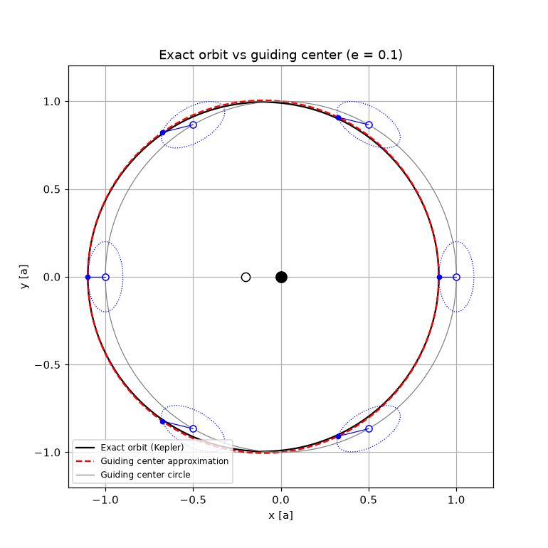
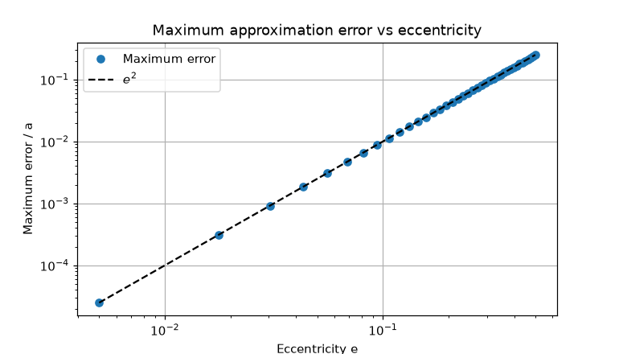

# The Guiding Center Approximation for Low-Eccentricity Orbits

For nearly circular orbits, Keplerian motion can be rebuilt from two simple uniform
motions, a modern version of the ancient epicycles:

1. a **guiding center** $G$ moving on a circle of radius $a$ at the mean motion $n$, and
2. a small ellipse around $G$, with semi-axes $ae$ (radial) and $2ae$ (along-track),
   described in a frame that **rotates** with $G$.

This notebook tests the approximation against the exact Keplerian orbit (Kepler's equation
solved with Newton's method) and shows why its error scales as $e^2$.

## Results

<p align="center"></p>

For $e = 0.1$ the exact orbit (black) and the approximation (red dashed) are nearly
indistinguishable, and the approximate body tracks the real one at every instant, not just
along the orbit's shape.

<p align="center"></p>

The maximum position error follows $e^2$ exactly. Expanding Keplerian motion to first order
in $e$ ($r \approx a(1 - e\cos M)$, $f \approx M + 2e\sin M$) gives precisely the guiding
center equations, so the approximation is the first-order theory and only the $e^2$ terms
are lost.

| Body | e | Max error |
|---|--:|--:|
| Venus | 0.0068 | 4.6e-5 a |
| Earth | 0.0167 | 2.8e-4 a (~40,000 km) |
| Moon | 0.0549 | 3.0e-3 a |
| Mercury | 0.2056 | 4.2e-2 a |

## Tech stack

Python · `numpy` · `matplotlib`

## Running it

```bash
pip install -r requirements.txt
jupyter notebook guiding_center_approximation.ipynb
```
